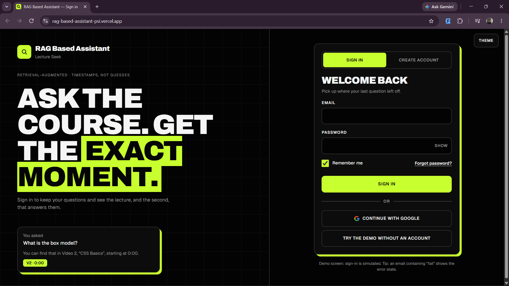
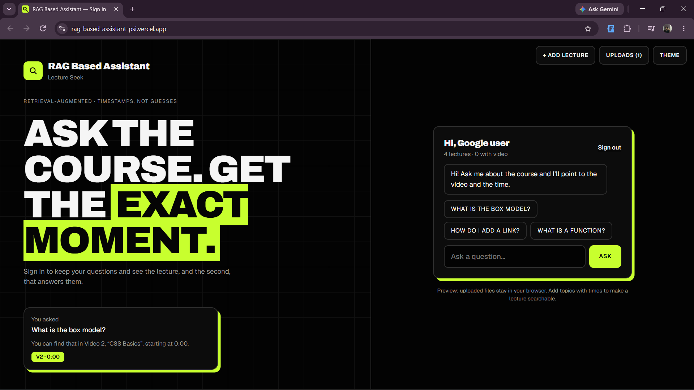
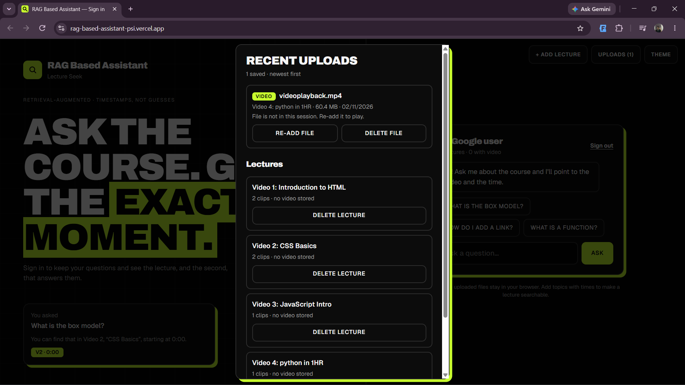
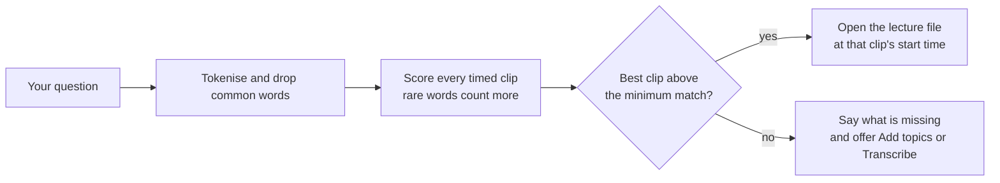

<div align="center">


<br><br>

**Ask a question about your lectures and jump straight to the video, at the second that answers it.**


[**Live demo**](https://rag-based-assistant-psi.vercel.app/) · [Features](#features) · [Preview](#preview) · [Run locally](#run-it-locally) · [Deploy](#deploy) · [Roadmap](#roadmap)

</div>

---

## What is this?

**RAG Based Assistant** (Lecture Seek) is a bold, mobile-friendly web app for searching *inside* lecture videos and audio.

You ask a normal question. Instead of a wall of text, it tells you **which lecture and which second** answers it, and opens the
player right there so you can start watching from that moment.

This repository is the complete front end: **one static page, no build step, no API keys.**

## Preview

### Sign in

Sign in, create an account, reset a password, or try the demo as a guest. Inline validation, a password strength meter,
and a layout that adapts from phone to desktop.



### Ask the assistant

Ask in plain language. The answer names the lecture and time (`V2 · 0:00`), and the matching video or audio opens in the chat,
already seeked to that second.



### Add your own lectures

Upload audio or video, make it searchable by transcribing it in your browser or by typing topics with times, and manage everything from the Uploads list.



> Screenshots use the built-in sample lessons and a small demo clip. Your own lectures work the same way.

## Features

**Ask and watch**
- Plain-language questions answered with the lecture, the time and a player that opens at that second
- Replay button, suggested questions, and a clear "not found" reply that tells you which lectures still have nothing to search

**Your own lectures**
- **Add lecture:** `mp3`, `mp4`, `m4a`, `wav`, `webm`, `mov` or `mkv`, as a new lecture or attached to an existing one
- **Make it searchable** in two ways:
  - **Transcribe (beta):** runs a small Whisper speech model *inside your browser* and indexes the whole lecture
  - **Add topics:** one line per topic with its time, like `2:15 What a string is`
- **Uploads history:** newest first, with name, type, size and time. Play, re-add or delete any entry
- **Delete anything:** a file, a whole lecture, or all uploads, each with a tap-again confirmation

**Accounts screens**
- Sign in, Create account, Forgot password and a guest demo, with a password strength meter

**Design**
- A very dark theme and a soft off-white light theme, bold type, hard borders and an electric accent
- Mobile first: large touch targets, no iOS zoom on inputs, safe-area aware, keyboard and screen-reader friendly
- Respects `prefers-color-scheme` and `prefers-reduced-motion`

## How it works



1. **Search:** each lecture is split into timed clips. A question is tokenised, common words are dropped, and each clip is scored by how many
   of the question's words it covers, weighting rare words higher (IDF).
2. **Player:** the winning clip's file opens in an `<audio>` or `<video>` element and seeks to the clip's start.
3. **Text for new lectures:** a web page cannot read audio by itself, so a new lecture is searchable by title only until you add topics or run Transcribe.
4. **Storage:** files live in memory for the current tab. The history list, topics and deletions are kept in `localStorage`.

The demo ships with three sample lessons (HTML, CSS and JavaScript basics) so you can try it straight away.

## Run it locally

No install needed.

```bash
git clone https://github.com/manthan707-ds/RAG-Based-Assistant-.git
cd RAG-Based-Assistant-

# any static server works
npx serve .
# or
python -m http.server 8000
```

Open the address it prints, for example http://localhost:8000.
Opening `index.html` directly also works, but Transcribe needs `http://` or `https://`.

## Deploy

It is a static site, so any host works.

| Host | Steps |
|---|---|
| **Vercel** | New Project, import the repo, Framework **Other**, leave build and output empty, Deploy |
| **Netlify** | Drag the folder onto https://app.netlify.com/drop, or connect the repo |
| **Cloudflare Pages** | Create a Pages project and upload the folder or connect the repo |
| **GitHub Pages** | Settings, Pages, deploy from branch `main` / root |

`vercel.json`, `netlify.toml` and `_headers` add security headers, including a Content-Security-Policy. GitHub Pages ignores them and the site still works.

## Project structure

```
.
├── index.html       # the whole app: HTML, CSS and JavaScript
├── vercel.json      # security headers for Vercel
├── netlify.toml     # security headers for Netlify
├── _headers         # security headers for Cloudflare Pages / Netlify
├── docs/
│   ├── banner.png
│   └── screenshots/ # login.png, assistant.png, upload.png
└── README.md
```

## Privacy and security

- Your lecture files **never leave your browser.** There is no upload server.
- The only network requests are Google Fonts and, if you use Transcribe, the speech library from jsdelivr and the model files from Hugging Face
  (about 40 MB, cached by the browser after the first run).
- The speech library is pinned to `@huggingface/transformers@3.7.6`, and the Content-Security-Policy allows only those hosts.
- Everything saved locally uses the keys `rba_uploads`, `rba_topics` and `rba_deleted`. Clear them from the Uploads panel or your browser settings.

## Current limitations

This is a front end demo, and it says so plainly:

- **Sign-in is simulated.** Any valid email and an 8+ character password works. Nothing is sent anywhere, and there is no Google sign-in yet.
- **Uploaded files are not stored permanently.** They live in the current tab, so re-add a file after a refresh to play it.
- **Transcribe is a beta.** It is slow on phones and very long videos, uses the small English model, and depends on your browser decoding the file.
- Search is keyword based, not semantic.

## Roadmap

- [ ] Backend (FastAPI): real accounts and sessions
- [ ] Upload endpoint with durable storage for lecture files
- [ ] Server-side Whisper transcription for videos of any length
- [ ] Semantic search with embeddings and AI-written answers grounded in the transcript
- [ ] Multi-course library and shareable links to a timestamp
- [ ] Automated tests (Playwright) and CI

## Tech stack

HTML5 · CSS custom properties (dark and light design tokens) · vanilla JavaScript · Web Audio API ·
[Transformers.js](https://github.com/huggingface/transformers.js) with Whisper tiny (optional) · Archivo and Geist fonts · Vercel.

## Contributing

Issues and pull requests are welcome. For a big change, please open an issue first so we can talk it through.

## License

Add a `LICENSE` file to choose one. MIT is a common choice for projects like this.

## Author

Built by **Manthan Ghodkhande**. If this helped you, a ⭐ on the repo is appreciated.
